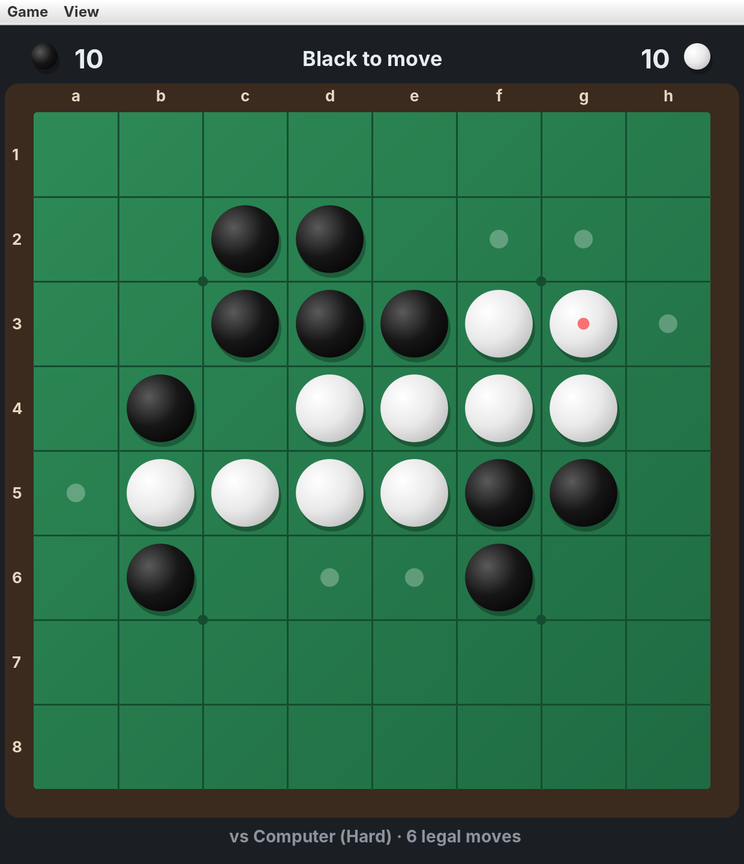
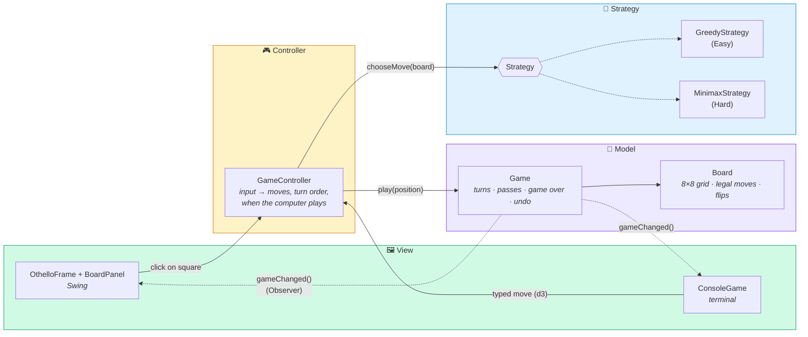
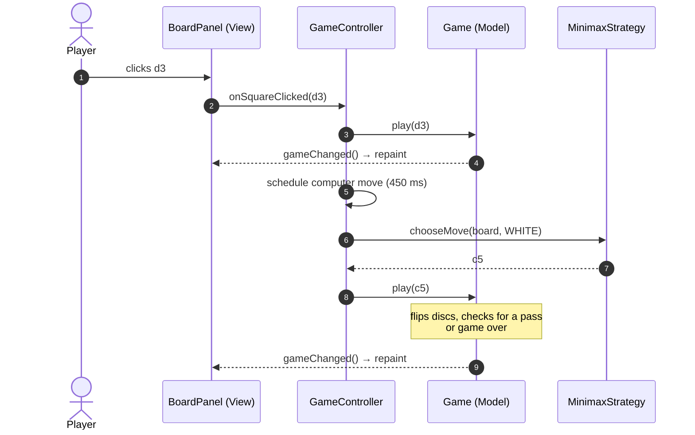

# ⚫⚪ Othello

[](https://github.com/Elyahu41/Othello/actions/workflows/ci.yml)


Othello (also called Reversi) in Java, with a Swing GUI, a console mode and two computer opponents. I first wrote it as a college project in 2020 and rebuilt it in 2026 with a cleaner architecture, correct rules and a real test suite.

<p align="center">
  
</p>

## ✨ Features

- **Swing GUI:** a hand-drawn board with shaded discs, legal-move hints, a preview disc when you hover over a legal square, a marker on the last move, a live score and undo (<kbd>Ctrl</kbd>+<kbd>Z</kbd>)
- **Three modes:** two players on one screen, vs Computer (Easy), or vs Computer (Hard)
- **Computer opponents:**
  - **Easy** plays whichever move flips the most discs right now.
  - **Hard** looks 4 moves ahead using *minimax with alpha–beta pruning*. It scores positions by square value (corners are worth a lot, the squares next to them are risky) and by how many moves each side has.
- **Console mode:** play in a terminal using standard notation (`d3`, `f5`, …)
- **Full rules:** a player with no legal move passes, and the game ends as soon as neither side can move, even if the board isn't full

## 🧩 Architecture

The code is split so that the game rules know nothing about the screen, and both front ends (Swing and console) drive the same model through the same controller. This is the Model–View–Controller pattern plus the **Observer** and **Strategy** patterns.



| Package | Responsibility |
|---|---|
| [`othello.model`](src/main/java/othello/model) | `Board` (placing discs, flipping, legal moves), `Game` (turns, passes, game over, undo, listeners), `Disc`, `Position`. Pure Java with no UI code, so it's easy to test. |
| [`othello.controller`](src/main/java/othello/controller) | `GameController` turns clicks and typed moves into model calls and schedules the computer's reply. `Mode` selects two-player, Easy or Hard. |
| [`othello.ai`](src/main/java/othello/ai) | `Strategy` interface with `GreedyStrategy` and `MinimaxStrategy`. Swapping in a new AI is a single class. |
| [`othello.ui`](src/main/java/othello/ui) | Swing view. It redraws whenever the model fires `gameChanged`. |
| [`othello.console`](src/main/java/othello/console) | Text view built on the same controller and model. |

### One turn against the computer



## 🚀 Running it

**Requirements:** JDK 21 or newer, plus Maven (or IntelliJ IDEA, which opens the `pom.xml` directly).

```bash
git clone https://github.com/Elyahu41/Othello.git
cd Othello
mvn package
java -jar target/othello.jar            # Swing window
java -jar target/othello.jar --console  # play in the terminal
```

In IntelliJ, open the folder and run `othello.Main`. Use **Game → New game** to switch modes. If there's no display available, the console version starts automatically.

### Console mode

```
    a b c d e f g h
  1 . . . . . . . .
  2 . . . . . . . .
  3 . . . * . . . .
  4 . . * W B . . .
  5 . . . B W * . .
  6 . . . . * . . .
  7 . . . . . . . .
  8 . . . . . . . .
  Black 2 | White 2
Black to move. Legal: d3 c4 f5 e6
> d3
Computer plays c5
```

`*` marks a legal move. Type `undo` to take back a move or `quit` to exit.

## 🧪 Tests

```bash
mvn test
```

There are 43 JUnit 5 tests covering:
- the opening position and legal moves
- flipping in several directions at once
- passing, and the game ending before the board is full
- draws and undo
- notation parsing
- the controller's turn order, including that a stale computer move is ignored after a new game
- both computer players always choosing legal moves through a full game, and Hard beating Easy with either colour

## 🔄 What changed from the 2020 version

| 2020 | 2026 |
|---|---|
| Board stored in a `static` field, so every game shared one board | Each `Game` owns its own `Board` |
| A corner could be taken just by having discs next to it | Correct capture rule: a line of opponent discs must end in one of yours |
| Game only ended when all 64 squares were filled, and there was no passing | Players pass when they have no move; the game ends when neither side can move |
| "Greedy" AI counted *neighbouring* discs, and crashed if it had no move | Easy AI counts discs actually flipped; added a Hard minimax AI |
| `OthelloModelOnePlayer` was both a model *and* a console UI | Separate model, controller, AI and views |
| GUI was a grid of coloured `JButton`s, and the end-game dialog said "It's a Tie!" when Black won | Custom-painted board with hints, previews, last-move marker, scores and undo |
| IntelliJ-only project with compiled `.class` files committed | Maven build, `.gitignore`, runnable JAR, CI |
| 6 JUnit 4 tests | 43 JUnit 5 tests |

---

Made by [Ely](https://github.com/Elyahu41)
